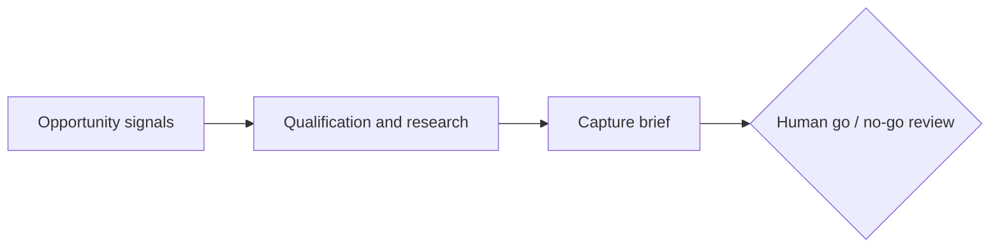
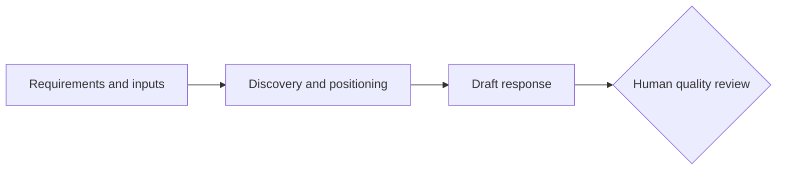

# THINK School

Two independently installable Managed Team plugins for Claude Code and OpenAI Codex: **Capture Team** and **Proposal Team**. Public educational plugins, distinct from Compound Leverage's proprietary managed-service runtime.

## Install a Managed Team

| Team | What it helps deliver | Claude Code | OpenAI Codex | Try it |
|---|---|---|---|---|
| **Capture Team** | Opportunity discovery, qualification, research, and capture briefs | [Install instructions](Plugins/README.md#claude-code) | [Package instructions](Plugins/README.md#openai-codex-packages) | [First assignment](Docs/quickstart-capture.md) |
| **Proposal Team** | Proposal research, assessment, strategy, drafting, and review | [Install instructions](Plugins/README.md#claude-code) | [Package instructions](Plugins/README.md#openai-codex-packages) | [First assignment](Docs/quickstart-proposal.md) |

Both can be installed directly from GitHub; official marketplace approval is not required.

**See the work before installing:** [Capture Brief example](Docs/samples/capture-brief.md) · [Proposal Discovery Brief example](Docs/samples/proposal-discovery-brief.md). Both are fictional examples, not real client work.

**How it works:** You assign work → a Managed Team prepares a deliverable → you review and approve it. Connected accounts and external actions require your authorization.

## What each team delivers

The examples below illustrate the work sequence; linked samples use fictional organizations and opportunities.

**Capture Team — from opportunity to capture decision**

[View fictional Capture Brief](Docs/samples/capture-brief.md)

**Proposal Team — from requirements to reviewed response**

[View fictional Proposal Discovery Brief](Docs/samples/proposal-discovery-brief.md)

## First assignment

- [Capture Team quickstart](Docs/quickstart-capture.md) · [Sample Capture Brief](Docs/samples/capture-brief.md)
- [Proposal Team quickstart](Docs/quickstart-proposal.md) · [Sample Discovery Brief](Docs/samples/proposal-discovery-brief.md)
- [Plugin release validation checklist](Docs/plugin-validation.md) — installation tests still pending

## Distribution: direct installation and official marketplaces

**Direct installation from GitHub is available independently of official marketplace approval.** Select the Claude Code or OpenAI Codex package in [Plugins](Plugins/README.md). Official marketplace listings provide an additional distribution channel, not a prerequisite for using the repository packages.

## Public marketplace

The repository provides two independently installable Growth Team plugins:

- **[Capture Team](Marketplaces/README.md)** — opportunity discovery, intake, intelligence, and capture support.
- **[Proposal Team](Marketplaces/README.md)** — research, assessment, positioning, drafting, and proposal QA.

Claude Code packages live under `Plugins/<team>/claude/`; Codex packages live under `Plugins/<team>/openai/`. These have different execution structures. [See platform-specific instructions](Plugins/README.md).

## Repository map

| Path | Purpose |
|---|---|
| [Marketplaces/](Marketplaces/README.md) | Choose platform-specific manifests and marketplace information |
| [Plugins/](Plugins/README.md) | Capture and Proposal plugin packages by platform |
| [Skills/](Skills/README.md) | Standalone reusable capabilities |
| [Docs/](Docs/README.md) | Architecture and operating guides |

Legacy materials are preserved on the [`legacy-archive` branch](https://github.com/Compound-Leverage/THINK-school/tree/legacy-archive/Archive), outside the current public plugin packages.

## Project information

[Latest release notes](Docs/RELEASE-NOTES-v1.1.0.md) · [License](LICENSE) · [Terms](TERMS.md) · [Privacy](PRIVACY.md) · [Support](SUPPORT.md) · [Contributing](CONTRIBUTING.md) · [Security](SECURITY.md)
